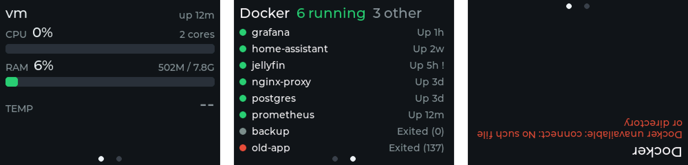
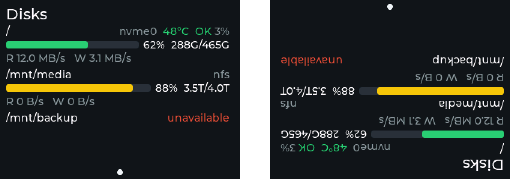

# rpusbdisp-status

Server status screen for the **RoboPeak Mini USB Display** (320×240, touch),
built with [LVGL](https://lvgl.io) on top of the usermode SDK from
[scrolltex/rpusbdisp](https://github.com/scrolltex/rpusbdisp).

Three pages, switched by swiping left/right or tapping the dots at the bottom.
The program starts on Overview and slides back to it after a minute without touch.

- **Disks** — space per filesystem (local and NFS), NVMe temperature, SMART
  badge (`OK` / `WARN` / `FAIL`, wear %), read/write activity
- **Overview** (home) — hostname, uptime, CPU, RAM, temperature, network speed
- **Docker** — running/other counts and a scrollable list of containers (read-only)




## Build

Ubuntu 26.04:

```bash
sudo apt install build-essential cmake pkg-config libusb-1.0-0-dev
git clone --recursive <this repo> rpusbdisp-status
cd rpusbdisp-status
# if you cloned without --recursive:
git submodule update --init

cmake -B build
cmake --build build -j
ctest --test-dir build          # unit tests, no hardware needed
```

Optional desktop preview window: `sudo apt install libsdl2-dev`, then
`cmake -B build -DSTATUS_SDL=ON` and `./build/rpusbdisp-status --backend sdl`.

## First run: check the hardware

```bash
sudo ./build/hwcheck
```

- Top half: four stripes, **red, green, blue, white** from left to right.
- Bottom half: a gradient from black to **red**.
- Colours are sent in BGR565, the order the RoboPeak display uses. If red and
  blue are swapped, your display is RGB: check with `sudo ./build/hwcheck --rgb`
  and start the program with `--color-order rgb`. If colours are garbled rather
  than swapped, add `--swap-bytes`.
- Touch the corners: the console prints coordinates, which should be close to
  `(0,0)` … `(319,239)`.
- Unplug and re-plug the cable: it should reconnect and redraw.

If it fails to open the device, make sure the kernel module is not loaded:
`sudo rmmod rp_usbdisplay`.

## Try it

```bash
sudo ./build/rpusbdisp-status                       # on the display
./build/rpusbdisp-status --backend dump --dump-dir /tmp   # renders /tmp/frame.ppm
./build/rpusbdisp-status --help
```

Options: `--rotate 0|180`, `--net-iface NAME` (NET speed interface, default: default route), `--fps N` (display updates per second, default 16), `--color-order bgr|rgb` (default bgr), `--swap-bytes`, `--temp-path FILE` (millidegrees,
auto-detected by default), `--docker-socket PATH`, `--start-page N` (relative to the home page: -1 Disks, 0 Overview, 1 Docker).

## Install as a service

```bash
sudo ./deploy/install.sh
journalctl -u status-display -f
```

The script creates the system user `statusdisp`, adds it to `plugdev`
(USB access via the udev rule) and `docker`, installs the binaries to
`/usr/local/bin`, the unit to `/etc/systemd/system` and the udev rule, and
starts the service.

To rotate the picture or swap bytes, edit `ExecStart` in
`/etc/systemd/system/status-display.service`, then
`sudo systemctl daemon-reload && sudo systemctl restart status-display`.

> **Security note.** Membership in the `docker` group is effectively root.
> The program only sends `GET /containers/json`, but if you want stronger
> isolation, put a read-only proxy such as
> [docker-socket-proxy](https://github.com/Tecnativa/docker-socket-proxy)
> in front of the socket and point `--docker-socket` at it.

## Disks page

- Filesystems are found automatically (ext4, xfs, btrfs, … and NFS); Docker
  overlays, snaps, `/boot` and duplicates are skipped. `--disks /,/mnt/media`
  picks them explicitly.
- A dead NFS server only marks its row `unavailable` (2 s deadline); the rest
  keeps working.
- SMART needs root, so `install.sh` installs `smartmontools` and the
  `rpusbdisp-smart.timer`, which runs `smartctl` every 10 minutes and writes
  `/run/rpusbdisp-status/smart/<device>.json`. The display program only reads
  these files (`--smart-dir` to change). A `?` after the badge means the data
  is older than 30 minutes.

## Adding a screen

1. Create `src/ui/screen_<name>.{h,cpp}` with a class derived from
   `status::Screen` (`name()`, `create(parent)`, `update(snapshot)`). Keep the
   bottom 18 px of the tile free for the page dots.
2. If it needs new data, add fields to `src/data/snapshot.h` and fill them in
   `src/data/collector.cpp`.
3. Register it in `src/main.cpp`. Pages left of Overview get negative numbers,
   pages right of it positive ones (`--start-page`), so keep `set_home()`
   pointing at Overview.

## Layout

```
src/data      metrics collection (/proc, /sys, Docker over a unix socket)
src/backend   output: rpusbdisp (USB), dump (PPM file), sdl (window)
src/ui        pager and screens
tools         hwcheck
deploy        systemd unit, udev rule, install script
third_party   lvgl, rpusbdisp (submodules), nlohmann/json, doctest
```
